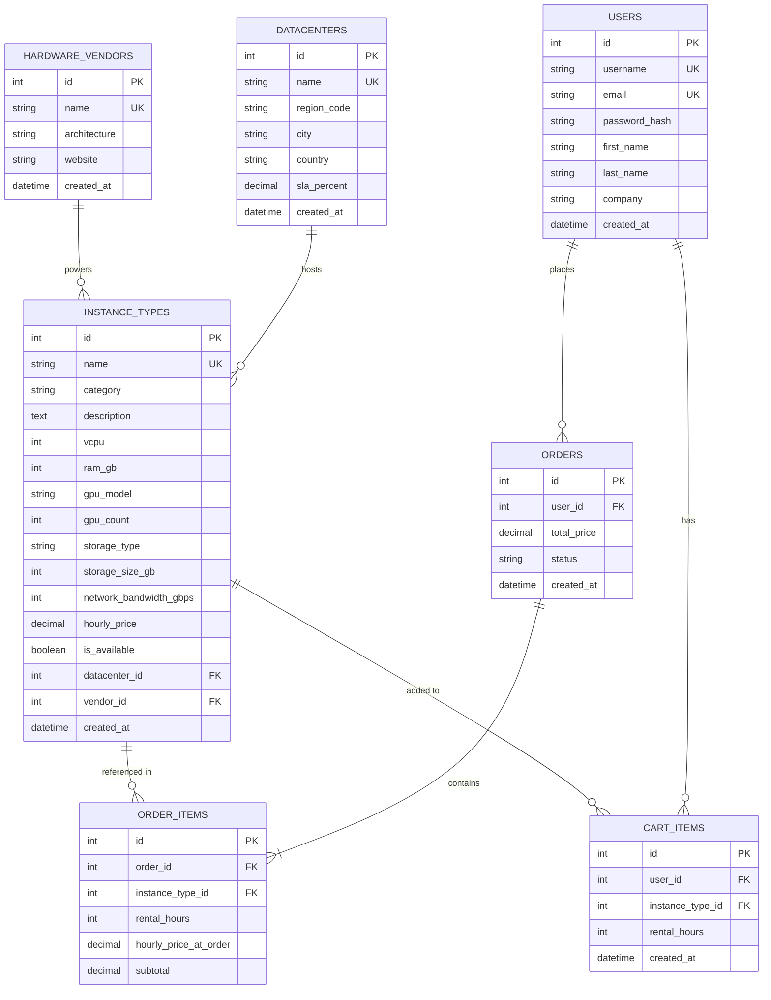

# SkyCompute — Cloud Compute & GPU Rental Platform

SkyCompute — це хмарна вебплатформа для оренди віртуальних серверів, високопродуктивних обчислювальних потужностей (vCPU/RAM) та спеціалізованих GPU/TPU прискорювачів для інженерів, ML-дослідників і стартапів (у стилі Google Cloud Compute Engine).

---

## 1. Опис застосунку та бізнес-логіка

Платформа надає розробникам і компаніям можливість орендувати обчислювальні ресурси під власні завдання (навчання нейромереж, обробка великих даних, хостинг мікросервісів) без необхідності купувати власне дороге серверне обладнання.

### Основні можливості системи:
* **Каталог серверних потужностей:**
  * Користувач може переглядати перелік доступних конфігурацій серверів (інстансів).
  * Пошук конфігурацій за назвою та характеристиками заліза.
  * Фільтрація за **датацентрами/регіонами розміщення**, **категоріями робочих навантажень** (General-Purpose, Compute-Optimized, Accelerator-Optimized / AI) та **апаратними вендорами**.
  * Сортування за погодинною вартістю оренди (від найдешевших до найдорожчих і навпаки), обсягом оперативної/графічної пам'яті та популярністю серед користувачів.
* **Детальна сторінка сервера:** Вичерпна інформація про конфігурацію: кількість ядер vCPU, тип і обсяг RAM, наявність і модель прискорювачів (GPU/TPU), тип накопичувача (NVMe SSD), пропускна здатність мережі та поточний статус доступності.
* **Датацентри та Регіони:** Перелік локацій розміщення інфраструктури (наприклад, Frankfurt, Iowa, Warsaw). На сторінці датацентру відображаються всі сервери, доступні саме в ньому.
* **Апаратні вендори / Архітектури:** Сторінка з виробниками серверного обладнання (Google TPU, NVIDIA, AMD). Користувач може відкрити сторінку платформи та побачити всі машини на базі цього вендора.
* **Управління даними (CRUD):** Адміністратори платформи можуть додавати нові типи серверів, оновлювати параметри існуючих, тимчасово виводити з експлуатації та видаляти застарілі конфігурації.
* **Автентифікація та Профіль:** Реєстрація розробника, авторизація, управління профілем (організація, контактні дані), перегляд повної історії орендованих ресурсів.
* **Кошик бронювання та Замовлення:** Клієнт обирає необхідні сервери і термін оренди (в годинах) у кошик. При натисканні «Оформити оренду» (Deploy) автоматично створюється замовлення з фіксацією вартості на момент бронювання (без додаткових платіжних шлюзів на цьому етапі).
* **Інформаційна сторінка:** Інформація про платформу, гарантії доступності (SLA 99.99%), контакти чергової служби підтримки та умови повернення коштів.

---

## 2. Архітектура REST API

Усі маршрути побудовані згідно з принципами RESTful API:
* Базовий префікс версіонування: `/api/v1/`
* Використання іменників у множині для ідентифікації ресурсів
* Обмін даними здійснюється у форматі **JSON** (`Content-Type: application/json`)
* Суворе дотримання семантики HTTP-методів (`GET`, `POST`, `PUT`, `PATCH`, `DELETE`) та відповідних статус-кодів

### 2.1. Каталог серверів (Compute Instances)

#### `GET /api/v1/instances`
* **Призначення:** Отримання каталогу конфігурацій серверів із фільтрацією, пошуком, сортуванням та пагінацією.
* **Query параметри:**
  * `search` *(string)*: пошук за назвою інстансу або моделлю GPU.
  * `category` *(string)*: фільтр за категорією (`general`, `compute_optimized`, `accelerator_optimized`).
  * `datacenter_id` *(integer)*: фільтр за ідентифікатором датацентру.
  * `vendor_id` *(integer)*: фільтр за вендором обладнання.
  * `sort` *(string)*: поле сортування (`price`, `-price`, `ram_gb`, `-ram_gb`, `-rent_count`).
  * `page` *(integer)*: номер сторінки (за замовчуванням `1`).
  * `limit` *(integer)*: кількість записів на сторінку (за замовчуванням `10`).
* **Response Status:** `200 OK`
* **Response Body:**
```json
{
  "total": 45,
  "page": 1,
  "limit": 10,
  "results": [
    {
      "id": 1,
      "name": "a2-highgpu-1g",
      "category": "accelerator_optimized",
      "vcpu": 12,
      "ram_gb": 85,
      "gpu_model": "NVIDIA A100 40GB",
      "gpu_count": 1,
      "hourly_price": "3.67",
      "datacenter": {
        "id": 2,
        "name": "europe-west3-a",
        "city": "Frankfurt"
      },
      "vendor": {
        "id": 1,
        "name": "NVIDIA"
      },
      "is_available": true
    }
  ]
}
```

#### `GET /api/v1/instances/{id}`
* **Призначення:** Детальна інформація про конкретну конфігурацію сервера.
* **Response Status:** `200 OK` / `404 Not Found`
* **Response Body (200 OK):**
```json
{
  "id": 1,
  "name": "a2-highgpu-1g",
  "category": "accelerator_optimized",
  "description": "Оптимізовано для тренування нейромереж та LLM інференсу.",
  "vcpu": 12,
  "ram_gb": 85,
  "gpu_model": "NVIDIA A100 40GB",
  "gpu_count": 1,
  "storage_type": "NVMe SSD",
  "storage_size_gb": 500,
  "network_bandwidth_gbps": 10,
  "hourly_price": "3.67",
  "is_available": true,
  "datacenter": {
    "id": 2,
    "name": "europe-west3-a",
    "region_code": "europe-west3",
    "city": "Frankfurt",
    "country": "Germany"
  },
  "vendor": {
    "id": 1,
    "name": "NVIDIA",
    "architecture": "Ampere"
  }
}
```

#### `POST /api/v1/instances`
* **Призначення:** Додавання нового типу сервера до каталогу (для адміністраторів).
* **Response Status:** `201 Created` / `400 Bad Request` / `401 Unauthorized` / `403 Forbidden`
* **Request Body:**
```json
{
  "name": "t2a-standard-4",
  "category": "general",
  "description": "Енергоефективний ARM інстанс для бекенду та мікросервісів.",
  "vcpu": 4,
  "ram_gb": 16,
  "gpu_model": null,
  "gpu_count": 0,
  "storage_type": "SSD",
  "storage_size_gb": 100,
  "network_bandwidth_gbps": 5,
  "hourly_price": "0.15",
  "datacenter_id": 1,
  "vendor_id": 3
}
```
* **Response Body (201 Created):**
```json
{
  "id": 15,
  "name": "t2a-standard-4",
  "category": "general",
  "description": "Енергоефективний ARM інстанс для бекенду та мікросервісів.",
  "vcpu": 4,
  "ram_gb": 16,
  "gpu_model": null,
  "gpu_count": 0,
  "storage_type": "SSD",
  "storage_size_gb": 100,
  "network_bandwidth_gbps": 5,
  "hourly_price": "0.15",
  "datacenter_id": 1,
  "vendor_id": 3,
  "is_available": true,
  "created_at": "2026-10-13T18:40:00Z"
}
```

#### `PUT /api/v1/instances/{id}`
* **Призначення:** Повне оновлення параметрів існуючого сервера.
* **Response Status:** `200 OK` / `400 Bad Request` / `404 Not Found`
* **Request Body:** Повна JSON-структура конфігурації сервера (як у `POST`).

#### `DELETE /api/v1/instances/{id}`
* **Призначення:** Видалення конфігурації сервера з каталогу.
* **Response Status:** `204 No Content` / `404 Not Found`

---

### 2.2. Датацентри та Регіони (Data Centers)

#### `GET /api/v1/datacenters`
* **Призначення:** Перегляд переліку всіх доступних датацентрів.
* **Response Status:** `200 OK`
* **Response Body:**
```json
[
  {
    "id": 1,
    "name": "us-central1-a",
    "region_code": "us-central1",
    "city": "Council Bluffs",
    "country": "USA",
    "sla_percent": "99.99"
  },
  {
    "id": 2,
    "name": "europe-west3-a",
    "region_code": "europe-west3",
    "city": "Frankfurt",
    "country": "Germany",
    "sla_percent": "99.99"
  }
]
```

#### `GET /api/v1/datacenters/{id}`
* **Призначення:** Отримання детальної інформації про конкретний датацентр.
* **Response Status:** `200 OK` / `404 Not Found`

#### `GET /api/v1/datacenters/{id}/instances`
* **Призначення:** Отримання всіх серверів, які розміщені у цьому датацентрі.
* **Response Status:** `200 OK` / `404 Not Found`

#### `POST /api/v1/datacenters`
* **Призначення:** Реєстрація нового датацентру в системі.
* **Response Status:** `201 Created` / `400 Bad Request`
* **Request Body:**
```json
{
  "name": "europe-central2-a",
  "region_code": "europe-central2",
  "city": "Warsaw",
  "country": "Poland",
  "sla_percent": "99.99"
}
```

#### `PUT /api/v1/datacenters/{id}`
* **Призначення:** Оновлення інформації про датацентр.
* **Response Status:** `200 OK` / `404 Not Found`

#### `DELETE /api/v1/datacenters/{id}`
* **Призначення:** Видалення датацентру.
* **Response Status:** `204 No Content` / `404 Not Found`

---

### 2.3. Апаратні вендори (Hardware Vendors)

#### `GET /api/v1/vendors`
* **Призначення:** Список виробників та архітектур обладнання.
* **Response Status:** `200 OK`
* **Response Body:**
```json
[
  {
    "id": 1,
    "name": "NVIDIA",
    "architecture": "Ampere / Hopper",
    "website": "https://www.nvidia.com"
  },
  {
    "id": 2,
    "name": "Google Cloud TPU",
    "architecture": "TPU v4 Tensor Core",
    "website": "https://cloud.google.com/tpu"
  }
]
```

#### `GET /api/v1/vendors/{id}`
* **Призначення:** Детальна інформація про вендора.
* **Response Status:** `200 OK` / `404 Not Found`

#### `GET /api/v1/vendors/{id}/instances`
* **Призначення:** Список усіх серверів, що працюють на апаратній базі обраного вендора.
* **Response Status:** `200 OK` / `404 Not Found`

#### `POST /api/v1/vendors`
* **Призначення:** Додавання нового вендора до платформи.
* **Response Status:** `201 Created` / `400 Bad Request`
* **Request Body:**
```json
{
  "name": "AMD",
  "architecture": "Instinct MI300X",
  "website": "https://www.amd.com"
}
```

#### `PUT /api/v1/vendors/{id}`
* **Призначення:** Редагування інформації про вендора.
* **Response Status:** `200 OK` / `404 Not Found`

#### `DELETE /api/v1/vendors/{id}`
* **Призначення:** Видалення вендора.
* **Response Status:** `204 No Content` / `404 Not Found`

---

### 2.4. Користувачі та Авторизація (Auth & Profile)

#### `POST /api/v1/auth/register`
* **Призначення:** Реєстрація нового користувача в системі.
* **Response Status:** `201 Created` / `400 Bad Request`
* **Request Body:**
```json
{
  "username": "ml_engineer",
  "email": "engineer@naukma.edu.ua",
  "password": "SecurePassword123!",
  "first_name": "Тарас",
  "last_name": "Шевченко",
  "company": "KMA AI Labs"
}
```

#### `POST /api/v1/auth/login`
* **Призначення:** Авторизація користувача та отримання токена доступу.
* **Response Status:** `200 OK` / `401 Unauthorized`
* **Request Body:**
```json
{
  "username": "ml_engineer",
  "password": "SecurePassword123!"
}
```
* **Response Body (200 OK):**
```json
{
  "token": "eyJhbGciOiJIUzI1NiIsInR5cCI6IkpXVCJ9...",
  "user_id": 1,
  "username": "ml_engineer"
}
```

#### `GET /api/v1/users/me`
* **Призначення:** Отримання даних профілю поточного авторизованого користувача.
* **Response Status:** `200 OK` / `401 Unauthorized`
* **Response Body:**
```json
{
  "id": 1,
  "username": "ml_engineer",
  "email": "engineer@naukma.edu.ua",
  "first_name": "Тарас",
  "last_name": "Шевченко",
  "company": "KMA AI Labs",
  "created_at": "2026-10-13T12:00:00Z"
}
```

#### `PATCH /api/v1/users/me`
* **Призначення:** Часткове редагування персональних даних профілю.
* **Response Status:** `200 OK` / `400 Bad Request`
* **Request Body:**
```json
{
  "company": "KMA Advanced Computing Lab",
  "first_name": "Тарас"
}
```

---

### 2.5. Кошик бронювання (Cart)

#### `GET /api/v1/cart`
* **Призначення:** Перегляд поточного кошика серверів, підготовлених до розгортання.
* **Response Status:** `200 OK` / `401 Unauthorized`
* **Response Body:**
```json
{
  "items": [
    {
      "id": 10,
      "instance_id": 1,
      "instance_name": "a2-highgpu-1g",
      "rental_hours": 24,
      "hourly_price": "3.67",
      "item_total": "88.08"
    }
  ],
  "total_price": "88.08"
}
```

#### `POST /api/v1/cart/items`
* **Призначення:** Додавання інстансу до кошика із зазначенням тривалості оренди.
* **Response Status:** `201 Created` / `400 Bad Request`
* **Request Body:**
```json
{
  "instance_id": 1,
  "rental_hours": 24
}
```

#### `DELETE /api/v1/cart/items/{id}`
* **Призначення:** Видалення інстансу з кошика.
* **Response Status:** `204 No Content` / `404 Not Found`

---

### 2.6. Оформлення та Історія замовлень (Orders / Leases)

#### `POST /api/v1/orders`
* **Призначення:** Оформлення замовлення (Checkout) з усіх серверів у кошику. Фіксує ціну оренди та автоматично очищує кошик.
* **Response Status:** `201 Created` / `400 Bad Request`
* **Response Body:**
```json
{
  "order_id": 42,
  "status": "active",
  "total_price": "88.08",
  "created_at": "2026-10-13T18:40:00Z",
  "items_count": 1
}
```

#### `GET /api/v1/orders`
* **Призначення:** Отримання історії всіх орендованих серверів та замовлень користувача.
* **Response Status:** `200 OK` / `401 Unauthorized`
* **Response Body:**
```json
[
  {
    "order_id": 42,
    "status": "active",
    "total_price": "88.08",
    "created_at": "2026-10-13T18:40:00Z",
    "items": [
      {
        "instance_name": "a2-highgpu-1g",
        "rental_hours": 24,
        "hourly_price_at_order": "3.67",
        "subtotal": "88.08"
      }
    ]
  }
]
```

#### `GET /api/v1/orders/{id}`
* **Призначення:** Детальна інформація про конкретне замовлення.
* **Response Status:** `200 OK` / `404 Not Found`

---

### 2.7. Інформація про платформу (About / SLA)

#### `GET /api/v1/info`
* **Призначення:** Отримання публічної інформації про платформу: контакти техпідтримки, параметри SLA та правила оренди.
* **Response Status:** `200 OK`
* **Response Body:**
```json
{
  "company_name": "SkyCompute Cloud Services Inc.",
  "support_email": "support@skycompute.io",
  "sla_uptime_target": "99.99%",
  "refund_policy": "Повернення невикористаних коштів протягом 48 годин з моменту відкриття тікету.",
  "terms_url": "https://skycompute.io/terms"
}
```

---

## 3. Схема бази даних (ER-діаграма)

Схема бази даних спроєктована в 3-й нормальній формі (3NF). Поле `hourly_price_at_order` у таблиці `order_items` гарантує збереження історичної ціни тарифу на момент здійснення замовлення (зміна ціни сервера в каталозі не змінить підсумкові суми в минулих замовленнях).


